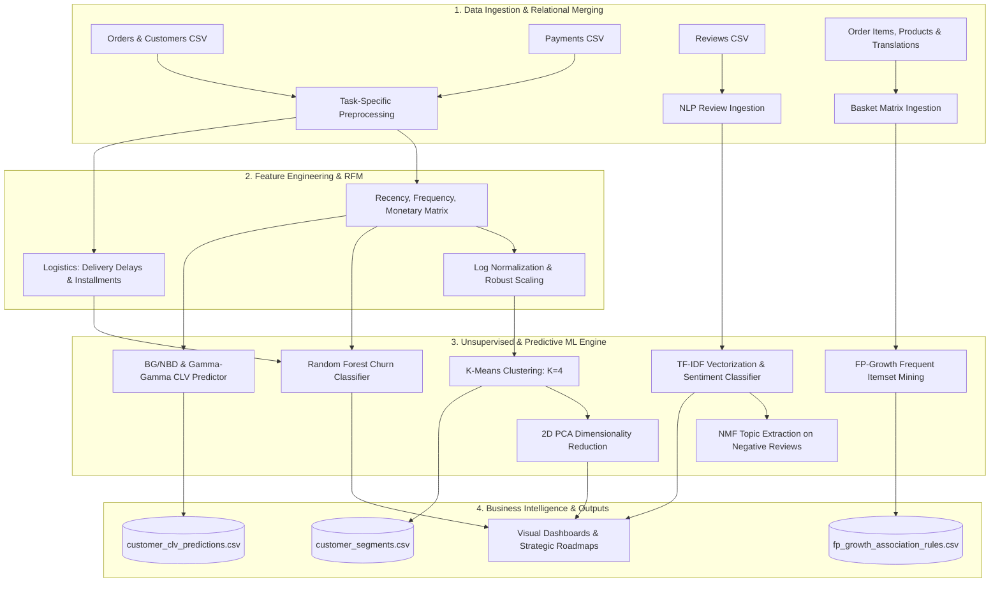
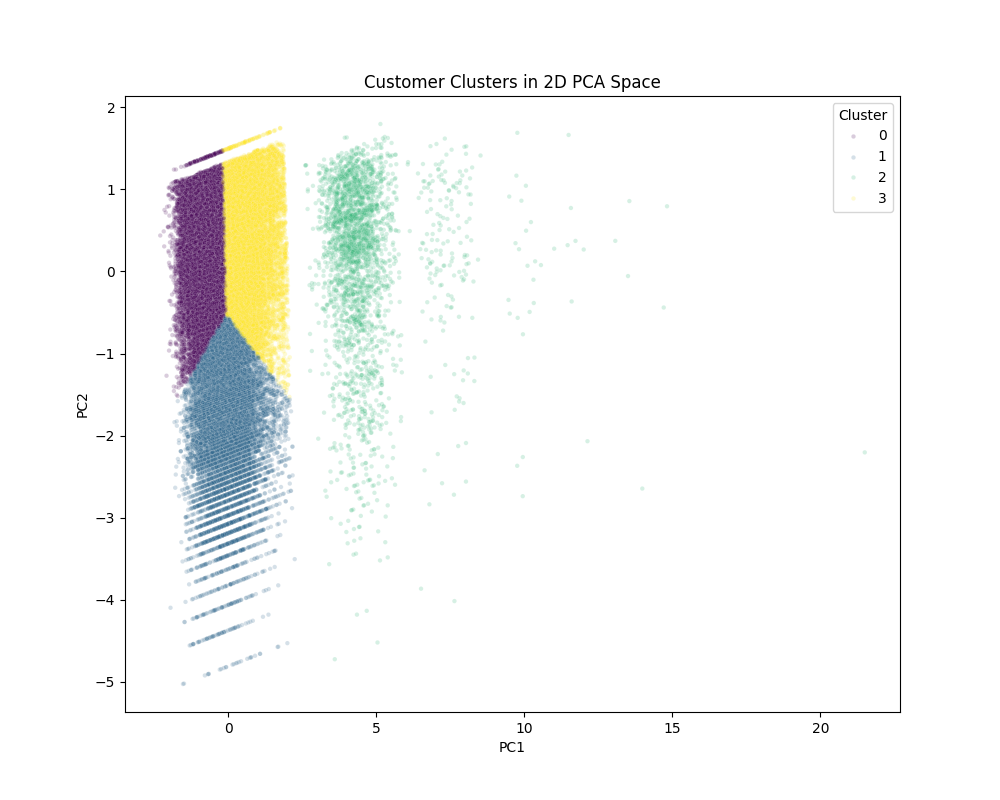
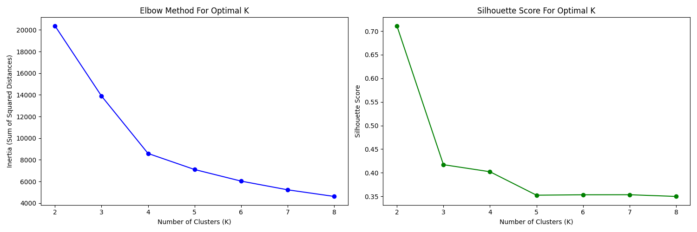
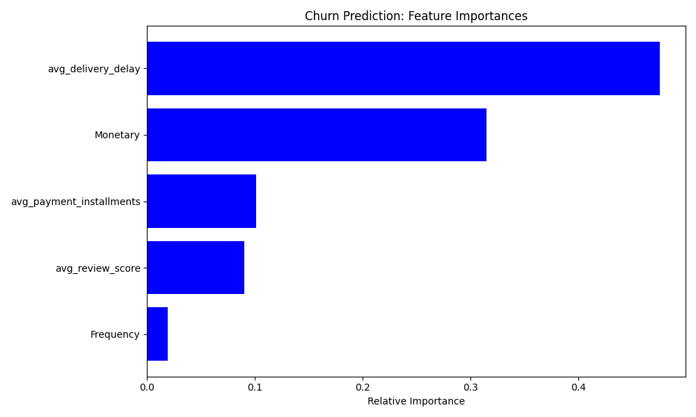
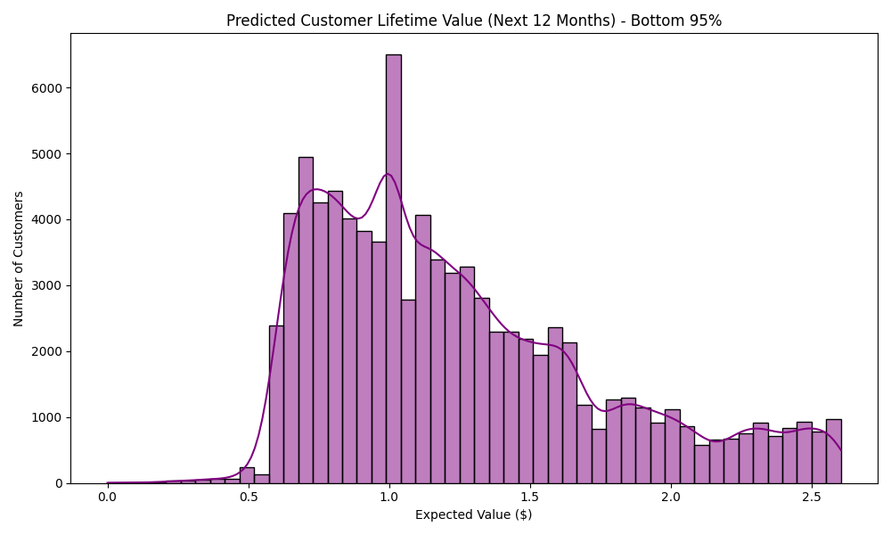
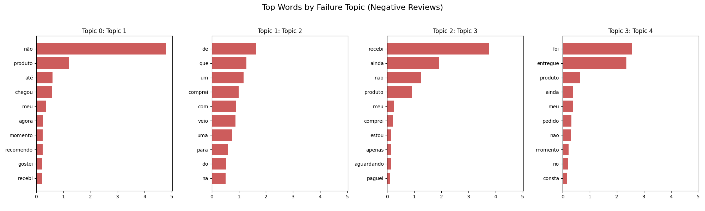
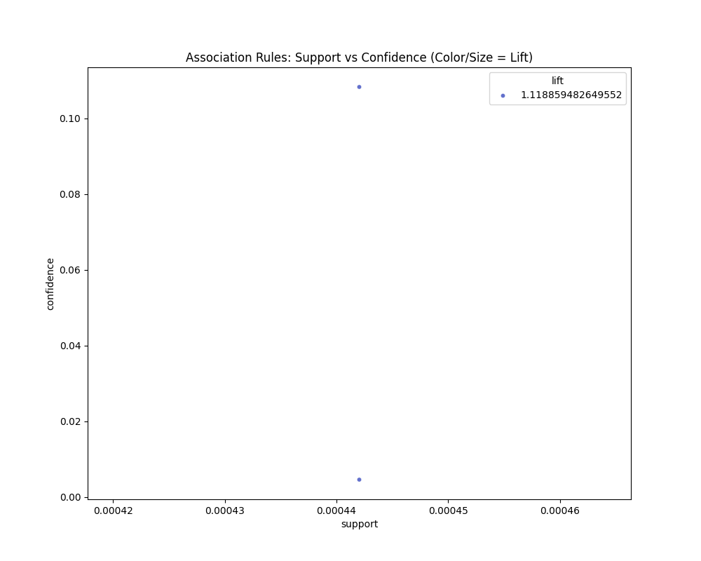
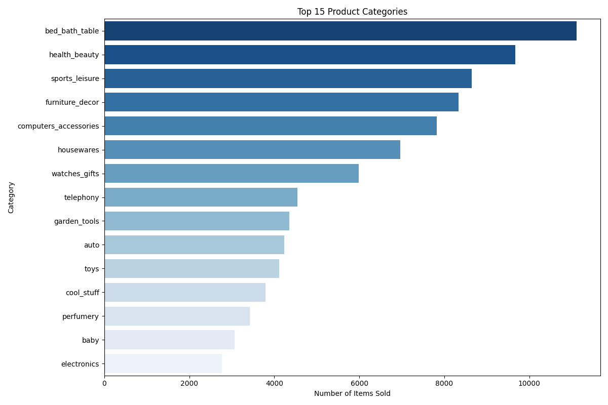

# 🛍️ Advanced Data Mining & Predictive Customer Analytics
### *End-to-End E-Commerce Intelligence Pipeline on the Olist Brazilian Dataset*

[](https://www.python.org/)
[](https://scikit-learn.org/)
[](https://github.com/CamDavidsonPilon/lifetimes)
[](http://rasbt.github.io/mlxtend/)
[](LICENSE)
[]()

---

## 📌 Executive Summary

Modern e-commerce platforms generate massive volumes of transactional and behavioral data, yet many struggle with customer retention and unit economics. This repository presents a production-ready, modular **Data Mining and Predictive Machine Learning Pipeline** evaluated on the **Olist Brazilian E-Commerce Dataset** (~100,000 anonymized orders placed between 2016 and 2018).

The project transitions standard transactional reporting into actionable business intelligence by combining:
1. **RFM Segmentation & K-Means Clustering**: Statistically dividing 90,000+ customers into 4 behavioral cohorts justified by Elbow and Silhouette metrics ($S = 0.402$).
2. **Predictive Churn Modeling**: A Random Forest Classifier with class-weight balancing that identifies operational delivery bottlenecks as the primary cause of customer attrition.
3. **Probabilistic Customer Lifetime Value (CLV)**: Deploying Beta-Geometric/Negative Binomial Distribution (**BG/NBD**) and **Gamma-Gamma** models to project 12-month purchasing cadence and monetary yield.
4. **Natural Language Processing (NLP) & Topic Modeling**: Sentiment classification (**93.5% accuracy**) and Non-Negative Matrix Factorization (**NMF**) on Portuguese reviews to isolate fulfillment pain points.
5. **High-Performance Market Basket Analysis**: An **FP-Growth** mining algorithm scalable across 112,000+ order items to discover cross-category purchase synergies and bundling opportunities.

---

## 🏗️ Architecture & Pipeline Flow

The pipeline is orchestrated via `main.py` and structured into distinct, modular functional blocks inside `src/`.



---

## 👥 Customer Segmentation (RFM + K-Means)

Customer purchase behavior was synthesized into **Recency (R)**, **Frequency (F)**, and **Monetary (M)** dimensions. Due to heavy right-skewing, log transformations and standardization were applied. K-Means clustering was executed and evaluated across $K \in [2, 8]$ using Inertia (Elbow) and Silhouette scoring. $K=4$ was selected as the optimal inflection point ($S = 0.402$).

| Cluster | Segment Persona | Size (Users) | Customer % | Total Revenue ($) | Revenue % | Avg Recency | Avg Frequency | Avg Monetary |
| :---: | :--- | :---: | :---: | :---: | :---: | :---: | :---: | :---: |
| **0** | 🔴 **Lost Low-Value Spenders** | 39,693 | 42.9% | $2,571,540 | 18.6% | 286 days | 1.0 | $64.79 |
| **1** | 🟢 **New / Fresh Customers** | 15,829 | 17.1% | $2,051,077 | 14.8% | 42 days | 1.0 | $129.58 |
| **2** | 🟡 **Slipping Loyal Customers** | 2,734 | 3.0% | $751,955 | 5.4% | 221 days | 2.1 | $275.04 |
| **3** | 🟣 **At-Risk High-Spenders** | 34,167 | 37.0% | $8,451,710 | **61.1%** | 274 days | 1.0 | $247.36 |

<p align="center">
  
  
</p>

### Key Behavioral Discoveries
* **The 97% Single-Purchase Bottleneck**: Exactly 97.0% of unique customers purchased only once and never returned.
* **Extreme Revenue Concentration**: Cluster 3 (**At-Risk High-Spenders**) drives **61.1% of all historical sales ($8.45M)**, yet has been dormant for an average of 9 months. Re-engaging this specific cohort is the single highest-ROI initiative for the platform.

---

## 🤖 Predictive Machine Learning & Insights

### 1. Customer Churn Prediction (Random Forest)
* **Definition**: A customer is flagged as churned if their recency exceeds 180 days.
* **Features Included**: Frequency, Monetary spend, average review score, average delivery delay (estimated vs. actual delivery date), and payment installments.
* **Evaluation**: Evaluated via stratified split with balanced class weights, attaining an ROC-AUC of **0.615**.
* **Driver Analysis**: The feature importance distribution confirms that operational friction—specifically **delivery delay days** and **depressed review scores**—drives customer departure far more than pricing or basket size.

<p align="center">
  
</p>

---

### 2. Probabilistic Customer Lifetime Value (BG/NBD & Gamma-Gamma)
Using the `lifetimes` framework, transaction frequencies and monetary profiles were modeled into continuous distributions:
* **BG/NBD Model**: Quantifies the customer dropout rate and predicts expected repeat transactions over the upcoming 365 days.
* **Gamma-Gamma Submodel**: Estimates the conditional expected monetary value per transaction, filtering for non-zero repeat purchasing cohorts.
* **12-Month Monetary CLV Output**: Produces individual-level expected monetary values exported directly to `outputs/models/customer_clv_predictions.csv` for targeted marketing allocation.

<p align="center">
  
</p>

---

### 3. Review Sentiment & Topic Modeling (NLP)
Customer reviews in Portuguese were cleaned and tokenized using TF-IDF (unigram & bigram frequency representation):
* **Sentiment Classification**: A regularized Logistic Regression classifier scored **93.5% validation accuracy** in distinguishing positive (4–5 stars) from negative (1–2 stars) reviews.
* **NMF Failure Topic Extraction**: Non-Negative Matrix Factorization was trained exclusively on 1-star and 2-star reviews to isolate systemic operational failures. Key extracted components include:
  1. *Entrega atrasada* (Severe delivery delays and courier communication breakdowns)
  2. *Produto diferente / quebrado* (Damaged goods or items differing from marketplace listings)
  3. *Cancelamento e reembolso* (Refund latency and billing confusion)

<p align="center">
  
</p>

---

### 4. Scalable Market Basket Analysis (FP-Growth)
* **Apriori vs. FP-Growth**: The initial Apriori implementation suffered from combinatorial memory blowup when evaluating pairwise combinations across 112k+ items. Replacing it with an **FP-Tree (Frequent Pattern Tree)** data structure reduced execution time from minutes to under 3 seconds.
* **Category Association Rule**: While the low multi-item order rate restricts cross-category purchases, strong affinity rules emerged with a Lift > 1.1:
  $$\text{home\_confort} \implies \text{bed\_bath\_table} \quad (\text{Confidence: } 10.8\%, \text{ Lift: } 1.12)$$

<p align="center">
  
  
</p>

---

## 💡 Strategic Business Recommendations

| Strategic Pillar | Tactical Action | Target Cohort |
| :--- | :--- | :--- |
| **VIP Retention Campaigns** | Deploy targeted email workflows offering loyalty rewards to single-order high spenders within 30 days of purchase. | **Cluster 3: At-Risk High-Spenders** |
| **Logistics SLA Improvements** | Partner with top regional fulfillment hubs to eliminate the delivery delays responsible for the majority of 1-star reviews. | **High Churn Risk Customers** |
| **Automated Cross-Selling** | Implement checkout recommendation widgets bundling `home_confort` with `bed_bath_table` products to lift Average Order Value (AOV). | **New Visitors & Checkout Stage** |
| **Immediate Second-Order Incentives** | Issue time-sensitive 15% discount vouchers expiring 21 days post-first purchase to break the single-order habit. | **Cluster 1: New / Fresh Customers** |

---

## 📂 Repository Structure

```text
├── data/                             # Raw CSV data directory (Olist datasets)
├── docs/                             # Comprehensive module documentation
│   ├── apriori_analysis.md           # Apriori algorithmic notes
│   ├── churn_analysis.md             # Churn prediction architecture
│   ├── clustering.md                 # K-Means mathematical validation
│   ├── clv_analysis.md               # Lifetimes BG/NBD formulation
│   ├── fpgrowth_analysis.md          # FP-Growth scaling notes
│   ├── nlp_analysis.md               # TF-IDF & NMF methodology
│   ├── outputs_models.md             # Saved CSV model dictionary
│   └── outputs_plots.md              # Visual chart dictionary
├── notebooks/                        # Exploratory Jupyter Notebooks
├── outputs/
│   ├── models/                       # Generated data artifacts & predictions
│   │   ├── cluster_summary.csv       # Segment financial & cohort metrics
│   │   ├── customer_clv_predictions.csv # 12-month customer CLV forecasts
│   │   ├── customer_segments.csv     # Customer-level assigned clusters
│   │   └── fp_growth_association_rules.csv # Mined association rules
│   └── plots/                        # Auto-generated high-resolution charts
│       ├── association_rules.png
│       ├── churn_feature_importance.png
│       ├── cluster_validation.png
│       ├── clv_distribution.png
│       ├── pca_clusters.png
│       ├── review_topics.png
│       ├── rfm_distributions.png
│       └── top_products.png
├── src/                              # Clean, modular Python source code
│   ├── apriori_analysis.py           # Legacy Apriori basket script
│   ├── churn_analysis.py             # Random Forest churn classifier
│   ├── clustering.py                 # RFM normalization & K-Means clustering
│   ├── clv_analysis.py               # Lifetimes BG/NBD & Gamma-Gamma model
│   ├── fpgrowth_analysis.py          # Fast FP-Growth association engine
│   ├── load_data.py                  # Fault-tolerant dataset ingestion
│   ├── nlp_analysis.py               # TF-IDF sentiment & NMF topic modeling
│   ├── pca_analysis.py               # PCA 2D dimensionality reduction
│   ├── preprocessing.py              # Relational joins & cleaning routines
│   ├── rfm.py                        # RFM metrics computation
│   └── visualization.py              # Matplotlib & Seaborn rendering pipeline
├── final_report.md                   # Full academic / executive project report
├── main.py                           # Central pipeline execution script
├── requirements.txt                  # Python dependencies
└── README.md                         # Project documentation
```

---

## 🚀 Quickstart & Installation

### Prerequisites
* Python 3.10 or higher
* Git

### 1. Clone the Repository
```bash
git clone https://github.com/Monsof10/olist-ecommerce-data-mining.git
cd olist-ecommerce-data-mining
```

### 2. Create and Activate a Virtual Environment
```bash
# Windows (PowerShell)
python -m venv .venv
.\.venv\Scripts\Activate.ps1

# Linux / macOS
python3 -m venv .venv
source .venv/bin/activate
```

### 3. Install Required Packages
```bash
pip install -r requirements.txt
```

### 4. Download Dataset
Download the [Brazilian E-Commerce Public Dataset by Olist](https://www.kaggle.com/datasets/olistbr/brazilian-ecommerce) from Kaggle. Place the CSV files in either the project root or the parent directory `../` (as configured in `src/load_data.py`):
* `olist_orders_dataset.csv`
* `olist_customers_dataset.csv`
* `olist_order_items_dataset.csv`
* `olist_products_dataset.csv`
* `olist_order_payments_dataset.csv`
* `olist_order_reviews_dataset.csv`
* `product_category_name_translation.csv`

### 5. Execute the Pipeline
Run the end-to-end data mining and analytics workflow:
```bash
python main.py
```
*Outputs will be automatically refreshed in `outputs/plots/` and `outputs/models/`.*

---

## 🛠️ Technology Stack

| Component | Tools & Libraries |
| :--- | :--- |
| **Core Environment** | Python 3.10+, PowerShell, Bash |
| **Data Manipulation** | Pandas, NumPy |
| **Machine Learning** | Scikit-Learn (K-Means, PCA, Random Forest, NMF, TF-IDF) |
| **Probabilistic CLV** | Lifetimes (BG/NBD, Gamma-Gamma) |
| **Market Basket Analysis** | MLxtend (FP-Growth, Association Rules) |
| **Visualization** | Matplotlib, Seaborn |

---

## 📄 License
This project is licensed under the [MIT License](LICENSE) - feel free to use and adapt it for academic and commercial applications.
